# Salam App

Aplikasi islami (Flutter) berisi tampilan **Login**, **Daftar**, **Home**,
**Quran**, **Menghafal**, **isi surah**, dan **mode hafalan (mushaf)**.

Login, Daftar, dan Home masih UI-only. Halaman **Quran** (daftar surah dan isi
surah) sudah memakai API publik **equran.id** beserta pemutar audio per ayat.

## Tampilan

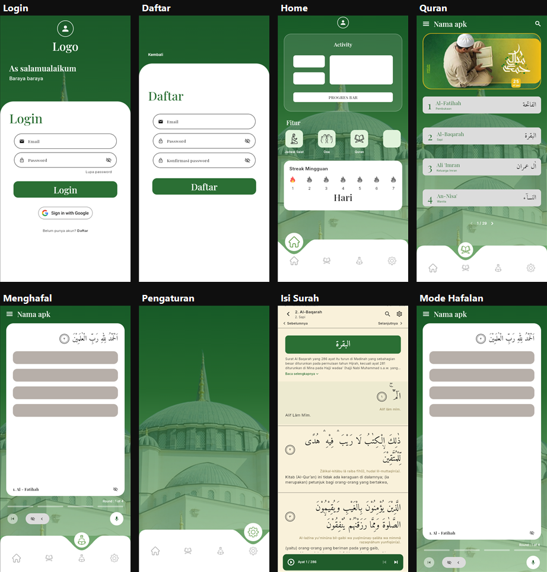

| Login | Daftar | Home | Quran |
| --- | --- | --- | --- |
| 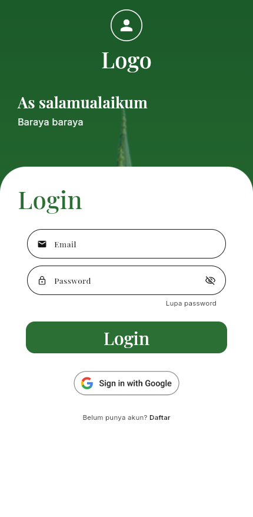 | 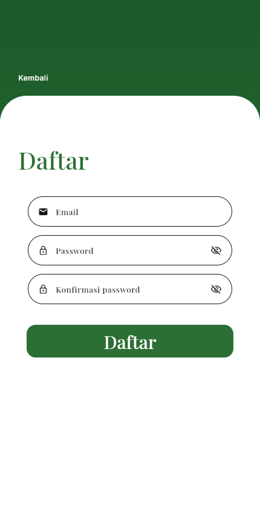 | 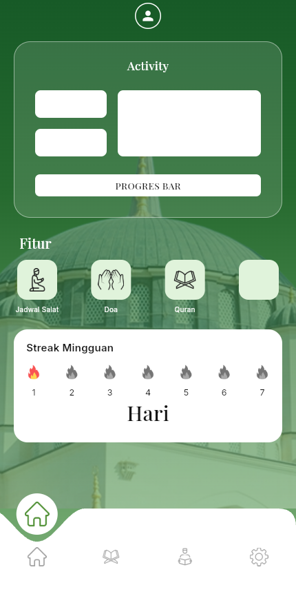 | 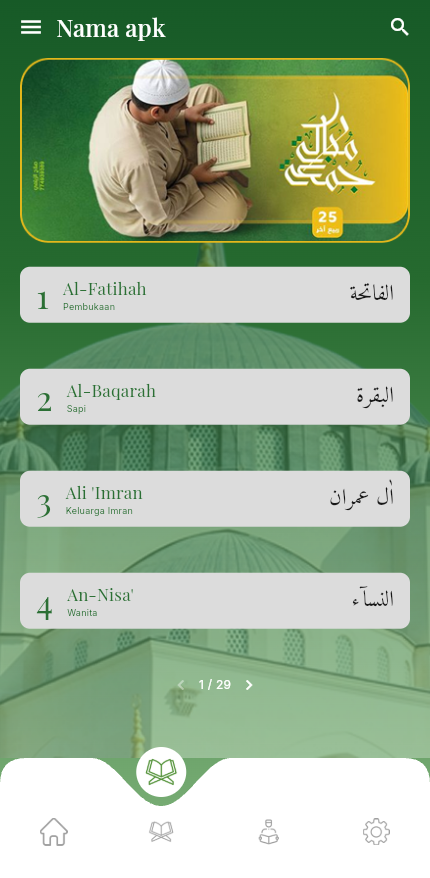 |

| Menghafal | Pengaturan | Isi surah | Mode hafalan |
| --- | --- | --- | --- |
| 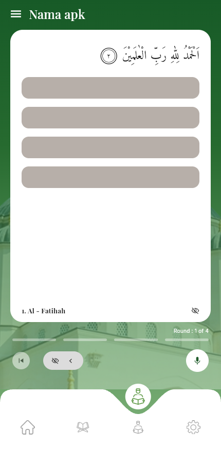 | 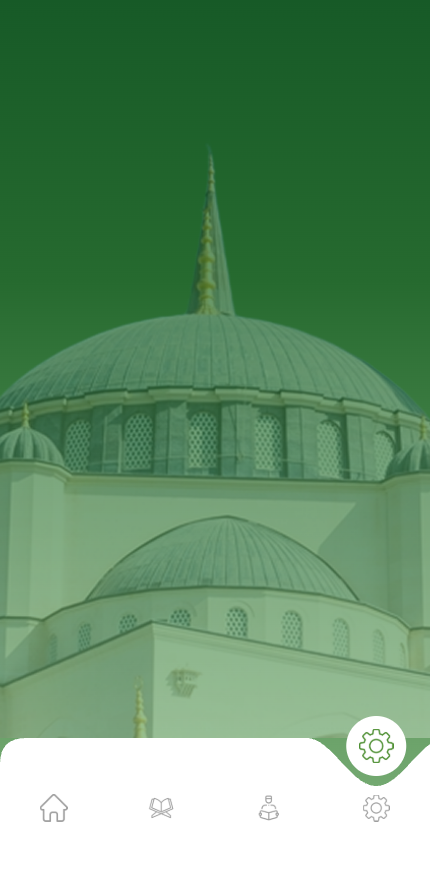 | 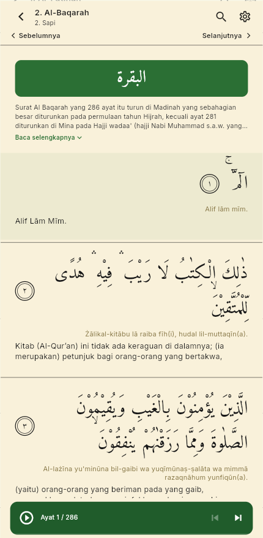 | 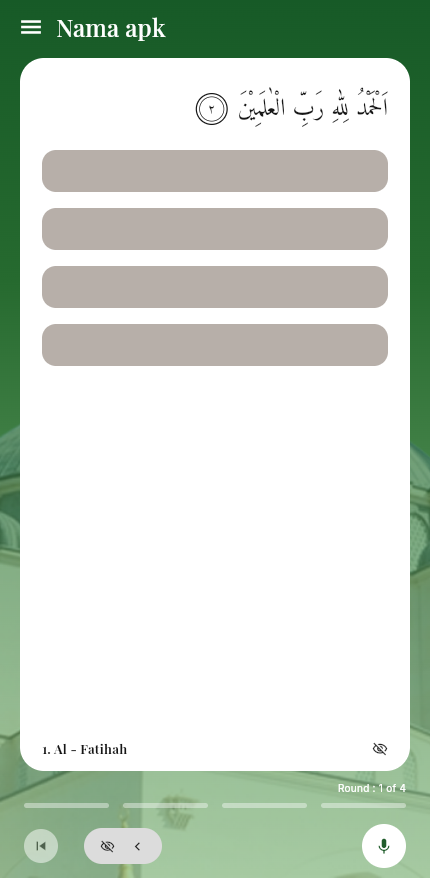 |

Pencarian surah (ikon search di tab Quran atau di halaman isi surah):

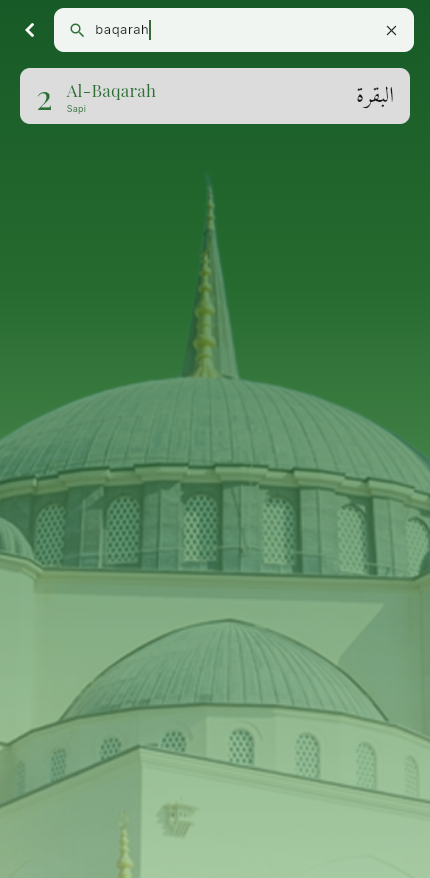

Perbandingan dengan video referensi: `screenshots/comparison.png`.

Saat tombol rekam ditekan, ayat muncul kata demi kata (simulasi pelafalan):

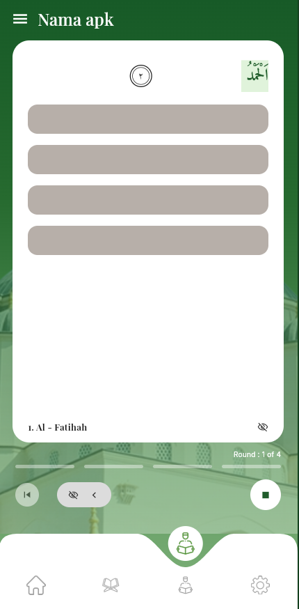

- **Login** — sapaan "As salamualaikum", form email & password, tombol login,
  Sign in with Google, dan tautan ke halaman Daftar.
- **Daftar** — form email, password, konfirmasi password.
- **Home** — kartu Activity, menu Fitur (Jadwal Salat, Doa, Quran), dan kartu
  Streak Mingguan, dengan background foto masjid di bagian bawah.
- **Quran** — tab kedua: banner, daftar 114 surah dari API (nomor, nama, arti,
  teks Arab), dan pagination 4 surah per halaman (29 halaman). Ikon search
  membuka halaman pencarian surah (cocok berdasarkan nomor, nama, arti, atau
  teks Arab). Bisa juga dibuka lewat menu **Quran** di Home.
- **Menghafal** — kartu ayat dengan terjemahan tersamar, indikator
  `Round : 1 of 4`, dan kontrol hafalan. Tombol mikrofon memulai "pelafalan":
  kata muncul satu per satu lalu otomatis lanjut ke round berikutnya. Tombol
  mata menampilkan terjemahan, tombol `|◁` kembali ke round sebelumnya, dan
  `‹` mundur satu kata.
- **Pengaturan** — tab placeholder yang sengaja hanya menampilkan background
  masjid.
- **Isi surah** — teks Arab, transliterasi, terjemahan, dan deskripsi surah
  dari API. Deskripsi panjang diringkas 3 baris dengan tautan
  **Baca selengkapnya** / **Sembunyikan**. Bar audio memutar bacaan per ayat:
  tombol play/pause, `skip previous`/`skip next`, dan progress bar. Setelah
  satu ayat selesai, pemutar otomatis lanjut ke ayat berikutnya. Ayat yang
  sedang diputar ikut tersorot. Di bawah header ada tautan **Sebelumnya** dan
  **Selanjutnya** untuk berpindah surah (disembunyikan bila tidak ada surah
  sebelumnya/berikutnya), dan ikon search membuka pencarian surah.
- **Mode hafalan** — tampilan yang sama, dibuka lewat ikon gear di halaman isi
  surah.

Bottom navigation memakai empat ikon tanpa label (Home, Quran, Menghafal,
Pengaturan). Tab aktif muncul sebagai lingkaran putih berisi ikon hijau di atas
bar putih yang diberi lekukan.

## API Quran & audio

Data diambil langsung dari [equran.id](https://equran.id/apidev/v2) (tanpa API
key):

| Keperluan | Endpoint |
| --- | --- |
| Daftar 114 surah | `GET https://equran.id/api/v2/surat` |
| Detail surah + ayat | `GET https://equran.id/api/v2/surat/{nomor}` |

Field yang dipakai: `namaLatin`, `nama`, `arti`, `jumlahAyat`, `tempatTurun`,
`deskripsi`, `teksArab`, `teksLatin`, `teksIndonesia`, `audio`/`audioFull`, serta
`suratSebelumnya`/`suratSelanjutnya` untuk tautan **Sebelumnya** dan
**Selanjutnya**.
Paket yang dipakai: `http` (permintaan API) dan `audioplayers` (pemutar audio).

Catatan penting:

- Base URL yang benar adalah `https://equran.id/api/v2`. Path `/apidev/v2`
  (yang tertulis di halaman dokumentasi) saat ini mengembalikan **404**.
- Audio ayat diputar dari `https://everyayah.com/data/Alafasy_128kbps/SSSAAA.mp3`
  (3 digit surah + 3 digit ayat). CDN equran.id (`cdn.equran.id`) tidak
  mengirim header CORS, sedangkan `audioplayers_web` memakai
  `crossOrigin = "anonymous"`, sehingga audio gagal di web. everyayah.com
  mendukung CORS dan memakai penomoran file yang sama.
- Kalau jaringan gagal, tab Quran dan halaman isi surah menampilkan data contoh
  dari `lib/data/quran_data.dart` beserta tombol **Coba lagi**.
- Android butuh `<uses-permission android:name="android.permission.INTERNET"/>`
  di `android/app/src/main/AndroidManifest.xml` (sudah ditambahkan).

## Menjalankan

```bash
flutter pub get
flutter run
```

Untuk melihat di browser:

```bash
flutter run -d chrome   # atau -d edge
```

Tab Quran memerlukan koneksi internet. Tanpa internet, aplikasi memakai data
contoh sehingga halaman tetap bisa dibuka.

## Struktur

```
lib/
  main.dart                  # MaterialApp + named routes
  data/
    quran_data.dart          # model Surah/Ayah + data contoh (fallback)
  services/
    quran_api.dart           # klien API equran.id + model SurahDetail
    quran_audio.dart         # penyusun URL audio per ayat
  theme/
    app_theme.dart           # palet warna, font, text style
    app_icons.dart           # path ikon PNG di assets/images/
  screens/
    login_screen.dart
    register_screen.dart
    home_screen.dart         # HomeShell (4 tab) + HomeScreen
    quran_list_screen.dart   # isi tab Quran (daftar surah)
    quran_search_screen.dart # pencarian surah
    surah_detail_screen.dart # isi surah
    menghafal_screen.dart    # tab Menghafal (kartu ayat + reveal bertahap)
    mushaf_screen.dart       # mode hafalan dari isi surah (bungkus MenghafalScreen)
    placeholder_screen.dart  # tab Pengaturan (kosong)
  widgets/
    app_bottom_nav.dart      # bottom nav 4 ikon dengan lekukan
    mosque_background.dart   # gradien hijau + foto masjid
    app_icon.dart            # penampil ikon PNG (+ pewarnaan)
    app_text_field.dart
    avatar_badge.dart
    ayah_marker.dart         # penanda nomor ayat
    surah_card.dart          # kartu surah (dipakai daftar & pencarian)
    feature_tile.dart
    google_sign_in_button.dart
    primary_button.dart
assets/fonts/                # Playfair Display, Inter, Amiri (Arab)
assets/images/               # ikon PNG, banner Quran, latar masjid
```

## Catatan

- Layar dikunci maksimal 430 px di perangkat lebar (web/desktop) agar proporsi
  tetap seperti ponsel.
- Ikon memakai gambar PNG di `assets/images/`. Ikon hitam diwarnai ulang lewat
  `color` (`BlendMode.srcIn`) di widget `AppIcon`: ikon navigasi abu-abu, ikon
  aktif hijau di dalam lingkaran putih. Api abu-abu memakai `BlendMode.modulate`
  agar tetap berbayang.
- `bg-masjid.png` sudah memiliki alpha sendiri (langit transparan), jadi
  digambar apa adanya. Gambar berhenti di atas bottom navigation melalui
  `bottomInset` agar posisi masjid sama dengan video.
- `icon-google.png` adalah versi potong dari `icon-sign in with google.png`
  (margin kosongnya dibuang) agar tombol pas dengan pill putih di belakangnya.
- `banner-quran.png` diambil dari frame video referensi.
- Teks Arab memakai font **Amiri** (`assets/fonts/Amiri-*.ttf`).
- Di video referensi, tombol di halaman Daftar bertuliskan "Login"; di sini
  diubah menjadi "Daftar" agar sesuai fungsinya.
- Teks "Nama apk" pada header masih mengikuti prototipe; ubah konstanta
  `_appName` di `quran_list_screen.dart` / `menghafal_screen.dart` bila perlu.
- Fitur hafalan saat ini berupa **simulasi**: kata muncul memakai timer, belum
  memakai mikrofon/speech-to-text. Untuk rekaman suara asli perlu menambah
  paket seperti `speech_to_text` beserta izin mikrofon.
- Titik edit API: `baseUrl` di `lib/services/quran_api.dart`, jumlah surah per
  halaman lewat `_pageSize` di `quran_list_screen.dart`, dan qari audio lewat
  `_base` di `lib/services/quran_audio.dart`.
